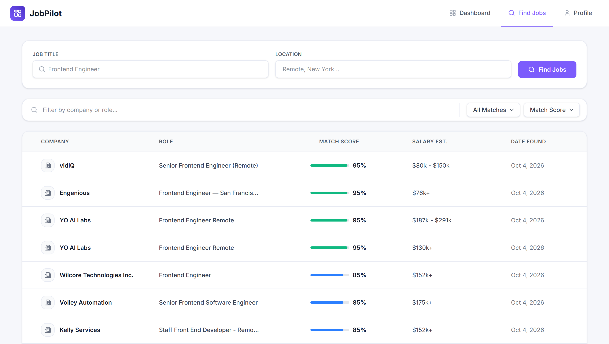
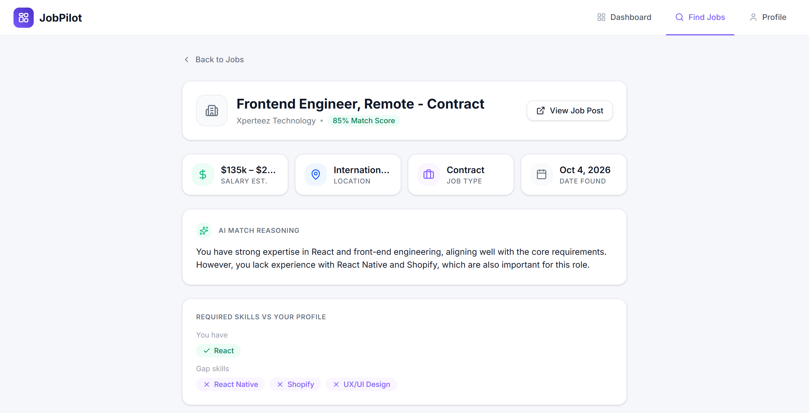
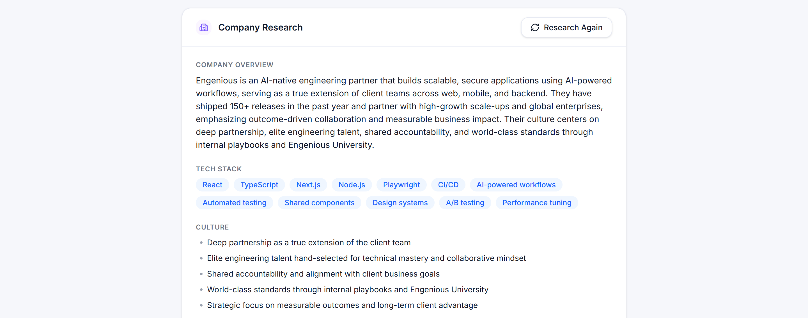
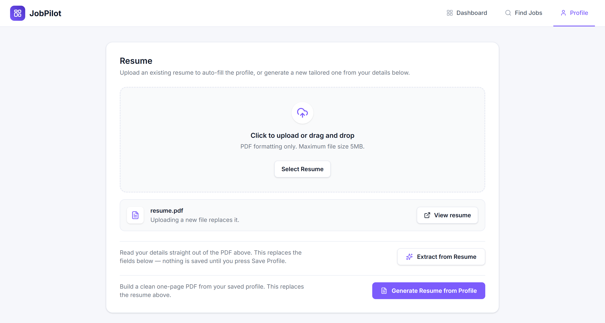

# Job Pilot

Job Pilot finds jobs that fit a candidate's profile, scores each one against it, and researches the employer, all from one dashboard.

## Screenshots

**Find Jobs** — scored jobs with search, filters and sorting.



**Job details** — the match reasoning and the skills the candidate has and is missing.



**Company research** — a dossier built by browsing the employer's website.



**Profile and resume** — upload, extract from, or generate a resume.



## Features

- **Profile and resume** — a complete profile form with a completion ring. A resume can be uploaded, read into the form (scanned PDFs are read by vision), or generated from the profile as a single-page PDF.
- **Job discovery** — searches Adzuna, collapses syndicated copies of the same posting, and scores each job against the profile with an LLM (score, reasoning, matched and missing skills).
- **Find Jobs** — filter, sort and paginate scored jobs, with filter state kept in the URL. Each job has a details page with the score breakdown and an apply link.
- **Company research** — a Browserbase and Stagehand session browses the employer's website, and the model turns what it finds into a nine-field dossier.
- **Dashboard** — stat cards computed from the user's jobs, plus Recharts charts built from PostHog events through the HogQL Query API.

## Tech stack

| Area | Choice |
| --- | --- |
| Framework | Next.js (App Router), React 19, TypeScript |
| Styling | Tailwind CSS 4 |
| Backend | InsForge: Postgres with row-level security, auth, file storage |
| LLM | OpenRouter, through the OpenAI SDK |
| Browser automation | Browserbase and Stagehand |
| Jobs data | Adzuna API |
| Analytics | PostHog (events and Query API) |
| PDF | `@react-pdf/renderer` for generation, `pdf-parse` for extraction |
| Validation | Zod |

## Project structure

```
app/          routes, route handlers (app/api) and layouts
tests/        unit tests
actions/      server actions for UI mutations
agent/        matcher, resume extractor and writer, company research, Adzuna client
components/   UI components grouped by page
lib/          data access, pure helpers and shared constants
db/schema.sql database schema and row-level-security policies
```

## Getting started

```bash
npm install
cp .env.example .env.local   # then fill in the values below
npm run dev
```

Open [http://localhost:3000](http://localhost:3000).

### Environment variables

| Variable | Purpose |
| --- | --- |
| `INSFORGE_PROJECT_URL`, `NEXT_PUBLIC_INSFORGE_URL`, `NEXT_PUBLIC_INSFORGE_ANON_KEY` | InsForge project URL (server and browser) and anon key |
| `OPENROUTER_API_KEY`, `OPENROUTER_MODEL` | LLM access and model id |
| `ADZUNA_APP_ID`, `ADZUNA_APP_KEY` | Job search |
| `BROWSERBASE_API_KEY` | Company research sessions |
| `NEXT_PUBLIC_POSTHOG_KEY`, `NEXT_PUBLIC_POSTHOG_HOST` | Event capture |
| `POSTHOG_PROJECT_ID`, `POSTHOG_PERSONAL_API_KEY` | Dashboard charts (a personal key with the `query:read` scope only) |

Without the PostHog query key the page still renders, and the charts show an "unavailable" message.

### Database and storage

1. Create an InsForge project and copy its URL and anon key into `.env.local`.
2. Apply `db/schema.sql` to the project's Postgres database. Every statement is idempotent, so it is safe to re-run. It creates the `profiles`, `agent_runs`, `jobs` and `agent_logs` tables, with row-level security so each user can only read and write their own rows.
3. Create a **private** storage bucket named `resumes`. Uploaded resumes are stored at `resumes/{user_id}/resume.pdf` and served through short-lived signed URLs.
4. Enable the Google and GitHub providers in the project's auth settings, and allow `http://localhost:3000/callback` as a redirect URL.

## Scripts

| Command | What it does |
| --- | --- |
| `npm run dev` | Start the development server |
| `npm run build` | Production build |
| `npm start` | Serve the production build |
| `npm run lint` | Run ESLint |
| `npm test` | Run the unit tests |

## Testing

`npm test` runs the unit tests with [Vitest](https://vitest.dev). They cover the pure logic that the pages depend on: dashboard stat and chart aggregation, profile completion, Find Jobs filter parsing and URL building, and employer-domain detection for company research. Network-facing code (Adzuna, the LLM calls, Browserbase, PostHog) is not mocked and is not covered by the suite.

## License

[MIT](LICENSE)
